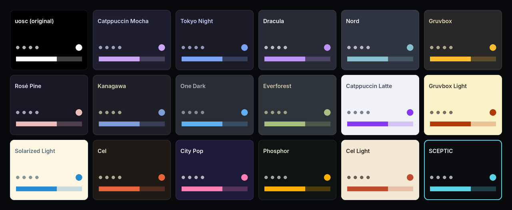

# Palettes

hikari ships a palette picker for uosc. Open it with the palette button in the controls bar or `Alt+p`, then pick a palette; it is applied straight away. Each palette is a uosc colour scheme with the names you may know from your editor or terminal theme.

- Dark: uosc (original), Catppuccin Mocha, Tokyo Night, Dracula, Nord, Gruvbox, Rosé Pine, Kanagawa, One Dark, Everforest.
- Light: Catppuccin Latte, Gruvbox light, Solarized light.
- Retro: Cel, City Pop, Phosphor, Cel light. hikari's own, after 80s and 90s anime rather than copied from a theme: Cel is hand-painted celluloid, City Pop the album covers and city nights of the 80s, Phosphor the amber and green screens of 90s science fiction, and Cel light is Cel by day.
- Custom: SCEPTIC, defined in `portable_config/scripts/hikari-palettes.lua`.

A palette can also set transparency through an optional `opacity` table (uosc's `opacity` keys, values 0 to 1); palettes without it use uosc's default opacity.

hikari owns uosc's `color` and `opacity` options: values set in `script-opts/uosc.conf` are overridden by the active palette. Customise them by editing a palette instead.

The choice is saved to `~~/hikari-palette.conf` (the mpv config folder, `portable_config/` in a portable install), which `mpv.conf` includes on start-up, together with the side bar style. A file saved by an older hikari, without it, means black bars. To bind another key, use `script-binding hikari_palettes/open-menu` in `input.conf`.

## Side bars

A 4:3 episode on a wider screen leaves a bar at each side of the picture. The last group of the palette menu, **Side bars (4:3)**, decides what they look like:

- **Black**: as mpv draws them. The default; hikari leaves mpv alone.
- **Palette colour**: the bars take the palette's `curtain` colour (mpv's `background-color`).
- **Retro stripes**: the palette colour plus three thin vertical stripes at the outer edge of each bar, in the palette's foreground, heatmap and match colours, like the spine of an 80s VHS box.

They follow the palette: pick another one and the bars change with it. hikari only touches them while the video really has bars at both sides; a 16:9 episode, a film with bars above and below, a picture, cover art or no file at all keep your own `background-color` (the one in your `mpv.conf`, or mpv's black), which hikari puts back as soon as the bars go. On an mpv without `background-color` the bars stay black (the stripes are still drawn), with a warning in the log. The stripes sit near the edge of the window rather than next to the picture so they stay clear of subtitles, which mpv lets spread into the bars and which the stripes would otherwise cover; a sign placed by hand right at the edge of the window can still end up under them. They are drawn below uosc, suji and the skip button, and work the same with any of them or with no interface at all. The option is `script-opts=hikari_palettes-bars=<black|palette|stripes>`.
