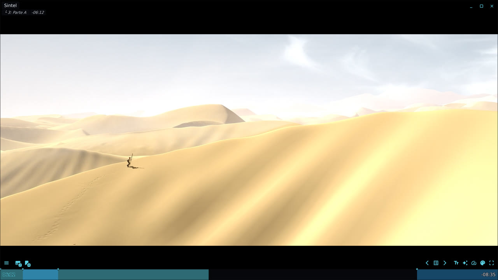
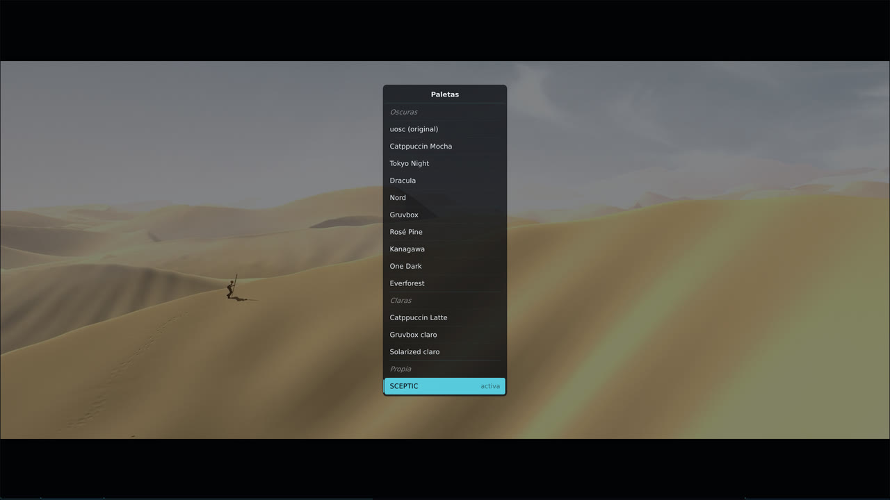
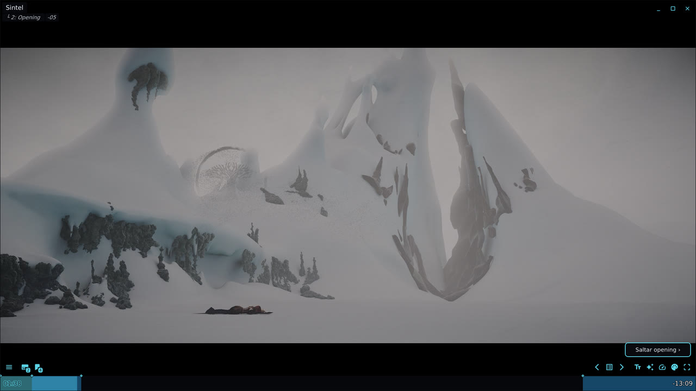
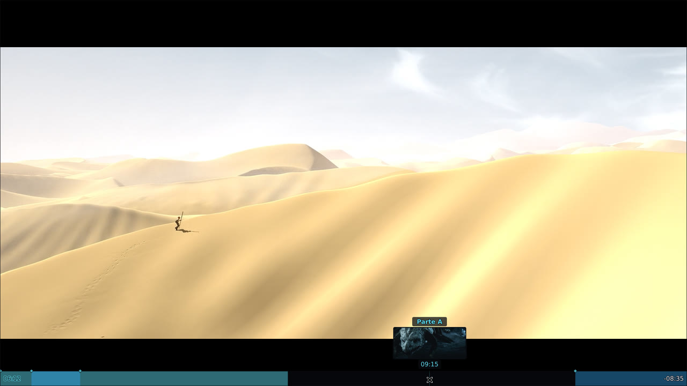
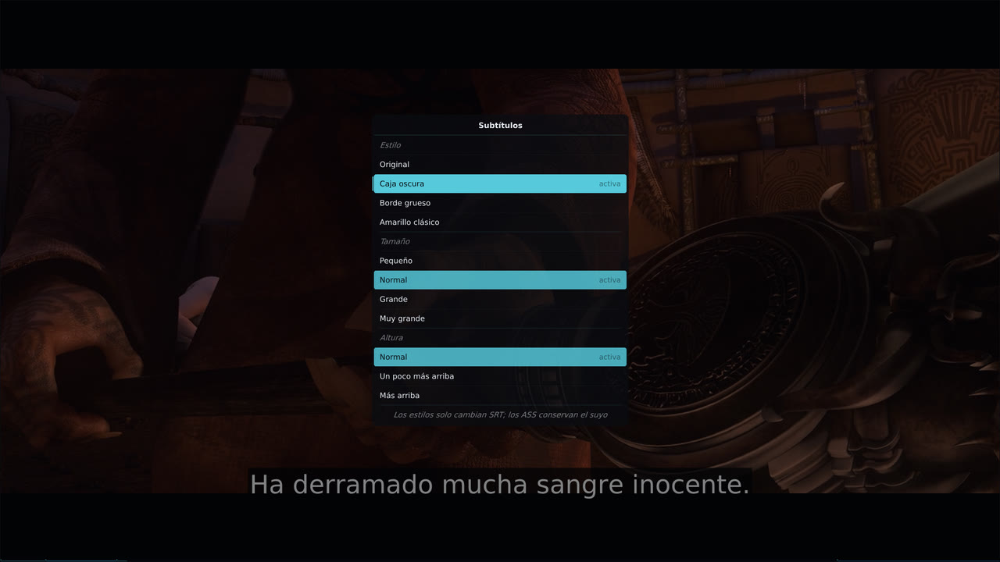
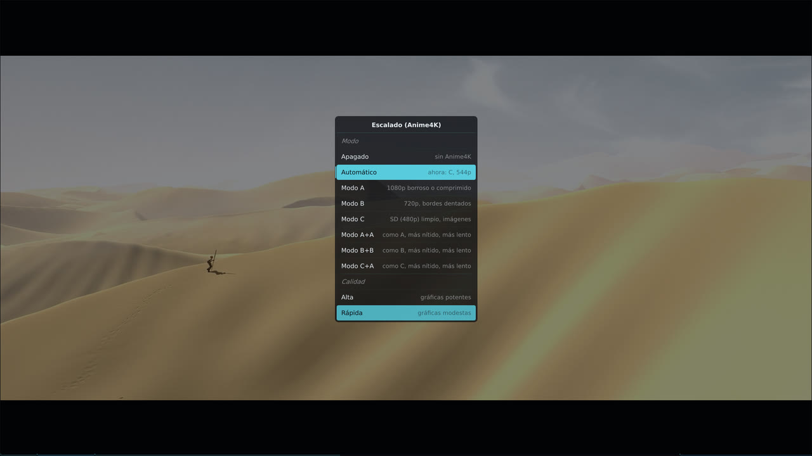

<div class="hk-hero" markdown>


# hikari, a modern theme for the mpv video player { .hk-title }

<p class="hk-tagline">Built on <a href="https://github.com/tomasklaen/uosc">uosc</a>, made for watching series and anime on <a href="https://mpv.io">mpv</a>.</p>

[Install :material-download:](#quick-install){ .md-button .md-button--primary }
[See it on GitHub :fontawesome-brands-github:](https://github.com/SCEPTICG/hikari-mpv){ .md-button }

<div class="hk-shot" markdown>

</div>

<p class="hk-dots" aria-hidden="true"><span style="--c:#ffffff"></span><span style="--c:#cba6f7"></span><span style="--c:#7aa2f7"></span><span style="--c:#bd93f9"></span><span style="--c:#88c0d0"></span><span style="--c:#fabd2f"></span><span style="--c:#ebbcba"></span><span style="--c:#7e9cd8"></span><span style="--c:#61afef"></span><span style="--c:#a7c080"></span><span style="--c:#8839ef"></span><span style="--c:#af3a03"></span><span style="--c:#268bd2"></span><span style="--c:#5ad4e6"></span></p>

</div>

hikari is a *skin* for mpv in the sense people usually mean: a ready-made, good-looking setup, not a new on-screen controller written from scratch. It installs the official uosc and [thumbfast](https://github.com/po5/thumbfast), configures them, and adds a few small Lua scripts of its own on top. Everything it changes in your config folder is backed up first, and it can be uninstalled. A one-minute showreel is on the [GitHub page](https://github.com/SCEPTICG/hikari-mpv).

## Quick install

=== "Windows"

    Open PowerShell (no administrator rights needed) and run:

    ```
    irm https://github.com/SCEPTICG/hikari-mpv/releases/latest/download/hikari.ps1 | iex
    ```

    It finds mpv, mpv.net and AnimeJaNai. Details: [Install on Windows](install/windows.md).

=== "macOS and Linux"

    Open Terminal (no `sudo`) and run:

    ```
    curl -fsSL https://github.com/SCEPTICG/hikari-mpv/releases/latest/download/hikari.sh | bash
    ```

    Details: [Install on macOS and Linux](install/macos-linux.md).

A menu opens: choose *Install or update* and the player. Run the same line again to update or to uninstall.

## What you get

<div class="grid cards" markdown>

-   :material-palette:{ .lg } **14 colour palettes**

    ---

    

    Catppuccin, Tokyo Night, Dracula, Nord, Gruvbox, Rosé Pine, Kanagawa, One Dark, Everforest, Solarized and hikari's own, SCEPTIC. `Alt+p`, applied at once.

    [:octicons-arrow-right-24: Palettes](features/palettes.md)

-   :material-skip-next:{ .lg } **Skip openings and endings**

    ---

    

    A *Skip opening ›* button while a chapter looks like an opening, intro or ending, or at the times AniSkip knows for anime episodes without them. One click or `Alt+s`.

    [:octicons-arrow-right-24: Skip openings and endings](features/skip.md)

-   :material-image-multiple:{ .lg } **Timeline thumbnails**

    ---

    

    Previews on hover through thumbfast, on network streams too, with the chapter name.

    [:octicons-arrow-right-24: Thumbnails](features/thumbnails.md)

-   :material-subtitles:{ .lg } **Subtitle styles**

    ---

    

    *Dark box*, *Thick outline* and *Classic yellow*, plus size and height. `Alt+t`.

    [:octicons-arrow-right-24: Subtitle styles](features/subtitles.md)

-   :material-auto-fix:{ .lg } **Automatic Anime4K**

    ---

    

    Anime4K's modes, and *Automatic*, which picks the mode from each video's resolution, with a quality for your graphics card.

    [:octicons-arrow-right-24: Anime4K upscaling](features/anime4k.md)

-   :material-monitor:{ .lg } **A controls bar for single episodes**

    ---

    

    A filled timeline with the opening and ending marked, readable titles for local files and streams, a speed menu, [continue watching](features/resume.md) for your files and an update notice.

    [:octicons-arrow-right-24: Keys and configuration](usage.md)

</div>

## Speaks your language

hikari's menus, buttons and messages come in the 13 languages of uosc. It follows your system, and `Alt+l` changes it. It also picks the audio and subtitle tracks for you: a dub in your language when the file has one, otherwise Japanese with subtitles in your language, telling Spain from Latin America and Brazil from Portugal. The installer speaks English or Spanish. [More about languages](features/language.md).

<p class="hk-chips"><span>English</span><span>Español</span><span>Deutsch</span><span>Français</span><span>Italiano</span><span>Polski</span><span>Português</span><span>Română</span><span>Русский</span><span>Türkçe</span><span>Українська</span><span>简体中文</span><span>繁體中文 (香港)</span></p>

## hikari and other mpv themes

- **[uosc](https://github.com/tomasklaen/uosc)** is the on-screen controller hikari is built on. If you already use uosc, hikari is a configuration plus a few scripts on top of it, not a fork: your uosc stays the official one.
- **[ModernX](https://github.com/cyl0/ModernX) and [ModernZ](https://github.com/Samillion/ModernZ)** are other replacements for mpv's built-in OSC. They clash with uosc, so the installer sets them aside (nothing is deleted) and puts them back on uninstall.
- **mpv.net and AnimeJaNai** are supported on Windows: hikari installs into the config folder each of them reads.

<small>Screenshots of the real player on Linux, with hikari in Spanish, with [Sintel](https://durian.blender.org/) © Blender Foundation (CC BY 3.0).</small>
